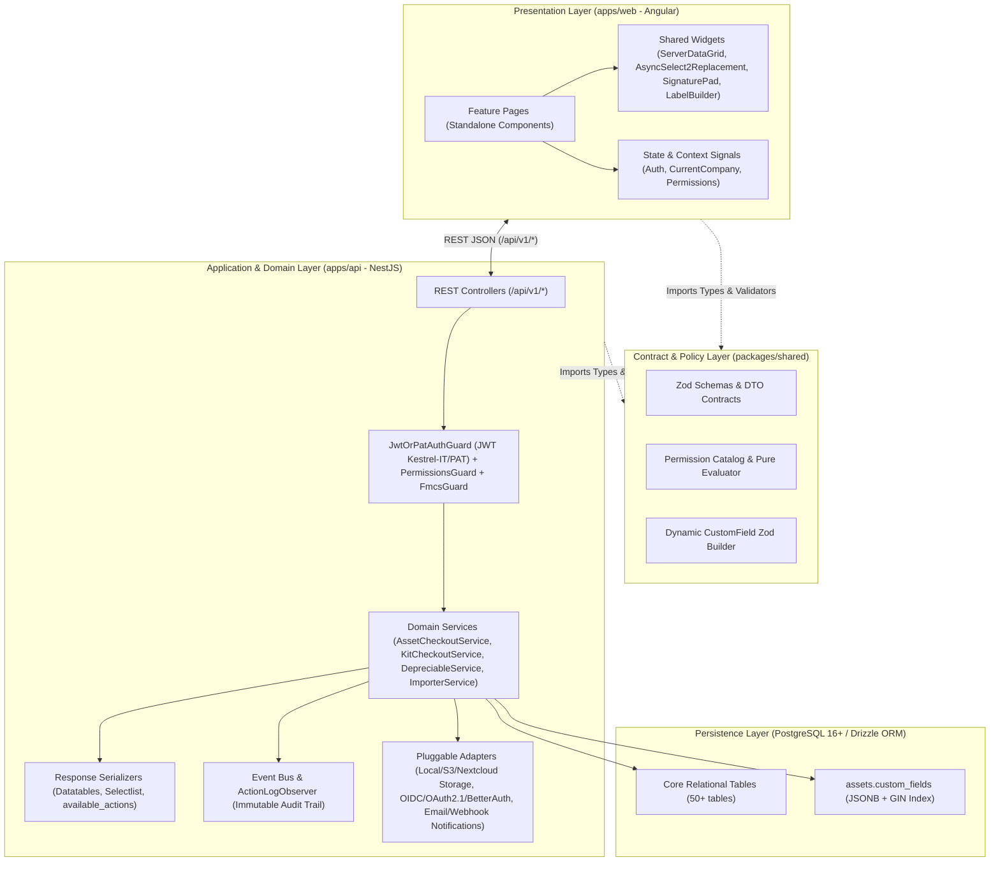

# 00 — Architecture Overview & Layer Mapping (Snipe-IT → Kestrel-IT)

## 1. Obiettivo e Filosofia Architetturale

**Kestrel-IT** è una reimplementazione clean-room in **TypeScript** di [**Snipe-IT**](https://github.com/grokability/snipe-it/tree/576e1c3c9e1ad67b7c7d53dcde49b9b7b5d253f8) con l’obiettivo di raggiungere la **parità funzionale e di API** con Snipe-IT modernizzando radicalmente lo stack tecnologico:

| Dimensione | Snipe-IT (`../snipe-it`) | Kestrel-IT (`kestrel-it`) | Vantaggio Architetturale |
| :--- | :--- | :--- | :--- |
| **Runtime & Linguaggio** | PHP 8.2+ / Laravel 12 (struttura Laravel 10) | **Node.js `v26.13.1`** (`.nvmrc`) + **TypeScript 5.x** | Tipizzazione statica end-to-end condivisa tra Backend e Frontend (`packages/shared`). |
| **Package Manager** | Composer + npm + Laravel Mix (Webpack) | **`pnpm@12.21.0` Workspaces** | Gestione monorepo deterministica, build veloci e condivisione pacchetti zero-copy. |
| **Backend Framework** | Doppio albero Controller (`Web` Blade + `Api` JSON) | **NestJS** (`@nestjs/platform-fastify`) | Un'unica API RESTful/OpenAPI modulare, Dependency Injection nativa, Guards, Interceptors e Pipes. |
| **Database & ORM** | MySQL / MariaDB + Eloquent ORM (513 migrazioni) | **PostgreSQL 16+** + **Drizzle ORM** | Query SQL type-safe, performance elevate, transazioni con lock espliciti e supporto nativo `JSONB` + indici `GIN`. |
| **Custom Fields** | Mutazioni DDL a runtime (`ALTER TABLE assets ADD _snipeit_*`) | Colonna **`custom_fields JSONB`** su `assets` + validazione dinamica **Zod** | Nessuna mutazione dello schema DB a runtime; indicizzazione GIN istantanea e zero lock DDL su tabelle grandi. |
| **Frontend UI** | Blade + AdminLTE 2 + Bootstrap 3 + jQuery (`snipeit.js`) + 18 widget Livewire | **Angular** (Standalone Components, Signals, Reactive Forms) | SPA reattiva, accessibile, disaccoppiata dal backend e senza dipendenza da jQuery/Bootstrap 3. |
| **Autenticazione** | Sessioni Laravel, Passport OAuth, LDAP, SAML 2.0, Google OAuth, TOTP e autenticazione API con bearer token OIDC | **Local/TOTP**, **OIDC e OAuth con PKCE**, **PAT**, bridge **Better Auth** | Il motore Better Auth embedded e le passkey sono nel [piano di lavoro](../PLAN.md). |
| **File Storage** | Laravel Filesystem (`local` / `s3`) | **Pluggable Storage Adapter** (`Local`, `Native S3`, `Nextcloud WebDAV`) | Supporto nativo per filesystem locale, S3/MinIO/R2 e istanze aziendali Nextcloud via WebDAV. |
| **Deployment** | VM / Docker monolitico Apache/PHP-FPM | **Docker Multi-Stage + Single Helm Chart** (`deploy/helm`) | Cloud-native, pronto per Kubernetes con un unico chart che orchestra API, Web e dipendenze opzionali. |

---

## 2. Struttura del Monorepo (`pnpm` Workspaces)

```text
kestrel-it/
├── .nvmrc                          # Node.js v26.13.1 (lts/lithium)
├── package.json                    # Workspace root (packageManager: pnpm@12.21.0)
├── pnpm-workspace.yaml             # Definizione pacchetti: apps/*, packages/*
├── tsconfig.base.json              # Configurazione TypeScript strict condivisa
├── PLAN.md                         # Master Execution Plan multi-fase
├── docs/                           # Documentazione di Reverse Engineering & Architettura
│   ├── 00-architecture-overview.md
│   ├── 01-database-schema-drizzle.md
│   ├── 02-custom-fields-jsonb-engine.md
│   ├── 03-rbac-policies-and-fmcs.md
│   ├── 04-domain-workflows-and-state.md
│   ├── 05-api-contracts-and-modules.md
│   ├── 06-storage-auth-and-jobs.md
│   ├── 07-frontend-angular-map.md
│   ├── rea-evidence-summary.json   # Sintesi delle evidenze statiche REA
│   └── 08-upstream-feature-map.md  # Funzionalità Snipe-IT e stato di parità
├── packages/
│   └── shared/                     # @kestrel-it/shared
│       ├── src/
│       │   ├── enums/              # StatusType, ActionType, CheckoutTargetType, CustomFieldElement...
│       │   ├── rbac/               # Catalogo Permessi, algoritmo risoluzione, helper FMCS
│       │   ├── schemas/            # Schemi Zod (DTO, Datatables, Selectlist, CustomField validators)
│       │   └── types/              # Interfacce di risposta API (available_actions, formatted dates)
├── apps/
│   ├── api/                        # @kestrel-it/api (NestJS + Fastify + Drizzle)
│   │   ├── src/
│   │   │   ├── main.ts
│   │   │   ├── app.module.ts
│   │   │   ├── config/             # Env validation (Zod) & ConfigModule
│   │   │   ├── db/                 # Drizzle connection, schema/*, migrations, seeders
│   │   │   ├── common/             # Guards (Auth, Permission, FMCS), Interceptors, StorageAdapters
│   │   │   ├── modules/            # Moduli di dominio (Assets, Models, Licenses, Users, Kits, ecc.)
│   │   │   └── jobs/               # Cron Scheduler & Background Workers (Alerts, Importer, Notifications)
│   └── web/                        # @kestrel-it/web (Angular Standalone + Signals)
│       ├── src/
│       │   ├── app/
│       │   │   ├── core/           # Auth, RBAC service, Company context, HTTP interceptors
│       │   │   ├── shared/         # ServerDataTable, AsyncSelect (selectlist), CustomFieldRenderer, Modals
│       │   │   └── features/       # Pagine per dominio (Dashboard, Hardware, Licenses, Users, Admin...)
└── deploy/
    └── helm/                       # Singolo Helm Chart Kubernetes per Kestrel-IT
```

---

## 3. Divisione dei Layer e Mappatura delle Responsabilità



### Come vengono eliminati i debiti tecnici di Snipe-IT:
1. **Eliminazione del Doppio Albero di Controller (`Web` vs `Api`)**:
   In Snipe-IT ogni entità ha due controller (`app/Http/Controllers/Assets/AssetsController.php` per Blade e `app/Http/Controllers/Api/AssetsController.php` per JSON), causando frequenti divergenze di validazione e permessi. In Kestrel-IT esiste **un solo Controller REST per risorsa** in `apps/api`, consumato sia dalla SPA Angular sia dalle integrazioni esterne.
2. **Eliminazione di `ALTER TABLE` a Runtime**:
   In Snipe-IT la creazione/modifica/cancellazione di un `CustomField` esegue `Schema::table('assets', ...)` aggiungendo/rinominando/eliminando colonne `_snipeit_<slug>_<id>`. In Kestrel-IT la tabella `assets` possiede una colonna `custom_fields JSONB NOT NULL DEFAULT '{}'::jsonb` indicizzata con `GIN`, eliminando qualsiasi mutazione DDL a runtime (vedi [`docs/02-custom-fields-jsonb-engine.md`](02-custom-fields-jsonb-engine.md)).
3. **Centralizzazione di FMCS (Full Multiple Company Support)**:
   In Snipe-IT il filtraggio per azienda è diviso tra `CompanyableScope`, controlli manuali `Company::isCurrentUserHasAccess($item)` in `SnipePermissionsPolicy::before()` e filtri manuali nei metodi `selectlist()`. In Kestrel-IT il contesto tenant/company dell'utente autenticato viene risolto una sola volta nel `RequestContext` ed applicato in modo uniforme dal `FmcsScopeHelper` di Drizzle e dal `PermissionsGuard` (vedi [`docs/03-rbac-policies-and-fmcs.md`](03-rbac-policies-and-fmcs.md)).

---

## 4. Tracciamento delle Funzionalità tramite REA (`reverse-engineer-anything`)

La [mappa funzionale](08-upstream-feature-map.md) collega il comportamento osservato in Snipe-IT al corrispondente progetto Kestrel-IT. I permalink puntano alla [revisione upstream di riferimento](https://github.com/grokability/snipe-it/tree/576e1c3c9e1ad67b7c7d53dcde49b9b7b5d253f8) usata per verificare la mappa. Il [piano di lavoro](../PLAN.md) indica le fasi di implementazione.

1. **Analisi statica REA del frontend JavaScript legacy** (`analyze_javascript_application`)
   - L'artefatto analizzato è `resources/assets/js`. La [sintesi REA versionata](rea-evidence-summary.json) registra l'hash dell'artefatto, gli ID delle evidenze e i limiti dell'analisi.
   - La sintesi riguarda 11 file JavaScript e riporta copertura applicativa parziale e copertura semantica non determinata. Il codice PHP, le rotte e i test upstream sono citati nelle voci della mappa che descrivono quei comportamenti.
   - Il riepilogo REA non registra il commit upstream dell'artefatto originale.

2. **Matrice dei Boundary di Ricostruzione (per `evaluate_reconstruction_coverage` & `verify_reconstruction`)**:

| Boundary ID | Scope in Snipe-IT | Target in Kestrel-IT | Specifica di Riferimento |
| :--- | :--- | :--- | :--- |
| `boundary.db.schema` | 513 migrazioni MySQL, 53 modelli Eloquent | `apps/api/src/db/schema/*` | [`docs/01-database-schema-drizzle.md`](01-database-schema-drizzle.md) |
| `boundary.custom_fields` | `CustomField`, `CustomFieldset`, `CustomFieldDefault` | `apps/api/src/modules/custom-fields/*` | [`docs/02-custom-fields-jsonb-engine.md`](02-custom-fields-jsonb-engine.md) |
| `boundary.rbac.fmcs` | `config/permissions.php`, 24 `Policies`, `CompanyableScope` | `packages/shared/src/rbac/*`, `apps/api/src/common/guards/*` | [`docs/03-rbac-policies-and-fmcs.md`](03-rbac-policies-and-fmcs.md) |
| `boundary.workflows` | `AssetCheckoutService`, `PredefinedKitCheckoutService`, `Depreciable` | `apps/api/src/modules/*/services/*` | [`docs/04-domain-workflows-and-state.md`](04-domain-workflows-and-state.md) |
| `boundary.api.rest` | `routes/api.php` (36 controller, 39 transformer) | `apps/api/src/modules/*/*.controller.ts` | [`docs/05-api-contracts-and-modules.md`](05-api-contracts-and-modules.md) |
| `boundary.ops.jobs` | `Auth`, `Storage`, 12 tipi di import CSV, 26 `Notifications`, `Console/Kernel` | `apps/api/src/common/storage/*`, `apps/api/src/jobs/*` | [`docs/06-storage-auth-and-jobs.md`](06-storage-auth-and-jobs.md) |
| `boundary.web.spa` | `resources/views/*`, `snipeit.js`, 18 componenti `Livewire` | `apps/web/src/app/*` | [`docs/07-frontend-angular-map.md`](07-frontend-angular-map.md) |
