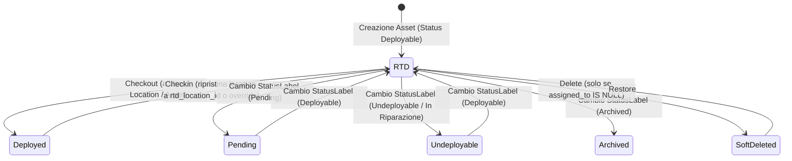

# 04 — Domain Workflows, State Machines & Business Calculations

Questo documento descrive la logica transazionale e le formule matematiche estratte dai Services e Models di Snipe-IT (`AssetCheckoutService`, `PredefinedKitCheckoutService`, `Depreciable`, `CheckoutAcceptance`, `CheckoutRequest`, `AdjustsQuantity`).

---

## 1. Macchina a Stati degli Asset e Checkout Polimorfico

### 1.1 Meta-Stati di un Asset (`Statuslabel` + Assegnazione)
Un Asset ha uno `status_id` che punta a `status_labels` (`deployable`, `pending`, `archived`) e un'assegnazione polimorfica `(assigned_to, assigned_type)`:

| `status_label` Flags | `assigned_to` | Meta-Stato Calcolato (`status_meta`) | Può fare Checkout (`availableForCheckout`)? | Può essere Eliminato? |
| :--- | :--- | :--- | :--- | :--- |
| `deployable = 1, pending = 0, archived = 0` | `NULL` | **`deployable`** (Ready to Deploy / RTD) | **Sì** (se `deleted_at IS NULL`) | **Sì** |
| `deployable = 1, pending = 0, archived = 0` | `NOT NULL` | **`deployed`** (Assigned) | **No** (deve prima fare Checkin) | **No** (deve prima fare Checkin) |
| `pending = 1` | `NULL` / `NOT NULL` | **`pending`** | **No** | Sì (se `assigned_to IS NULL`) |
| `archived = 1` | `NULL` / `NOT NULL` | **`archived`** | **No** | Sì (se `assigned_to IS NULL`) |
| `deployable = 0, pending = 0, archived = 0` | `NULL` / `NOT NULL` | **`undeployable`** | **No** | Sì (se `assigned_to IS NULL`) |



---

### 1.2 Flusso Transazionale di Checkout Asset ([`AssetCheckoutService.php`](https://github.com/grokability/snipe-it/blob/576e1c3c9e1ad67b7c7d53dcde49b9b7b5d253f8/app/Services/AssetCheckoutService.php))

Quando viene invocato `POST /api/v1/hardware/{id}/checkout` (o `/bytag/{tag}/checkout` o Bulk Checkout):

1. **Lock & Pre-condizioni (Transazione Drizzle `FOR UPDATE`):**
   - L'asset deve esistere, avere `deleted_at IS NULL` ed essere `availableForCheckout() === true`.
   - **Guardia Auto-Assegnazione:** Un asset non può fare checkout a se stesso (`targetType === 'asset' && target.id === asset.id`).
   - **Guardia FMCS (`canCheckoutTo`):** Se FMCS è attivo, `asset.companyId` deve essere compatibile con il target (`User`, `Location` o `Asset`).
2. **Risoluzione della Posizione (`location_id` vs `rtd_location_id`):**
   - `rtd_location_id` (Ready-To-Deploy / Home Location) **non viene modificato** durante il checkout.
   - `asset.locationId` viene aggiornato in base al tipo di target:
     - Se `target` è una **`Location`** → `asset.locationId = target.id`
     - Se `target` è un **`Asset`** → `asset.locationId = target.locationId ?? target.rtdLocationId`
     - Se `target` è un **`User`** → `asset.locationId = target.locationId` (può essere `null`)
3. **Propagazione dei License Seats collegati all'Asset (`propagateLicenseSeats` - Fix `GHSA-9wq4-gp32-rcgj`):**
   - Se `target` è un `User` e l'asset ha dei `license_seats` associati (`license_seats.asset_id = asset.id`):
     - **Validazione preventiva su ogni seat:**
       - Se `seat.unreassignableSeat === true` → lancia `CheckoutNotAllowedException`.
       - Se `seat.assignedTo !== null && seat.assignedTo !== target.id && !seat.license.reassignable` → lancia `CheckoutNotAllowedException`.
     - **Aggiornamento seats:**
       - Per ogni seat che aveva un precedente `assignedTo !== target.id`: elimina eventuali `CheckoutAcceptance` pendenti del vecchio utente per quel seat, emette un evento `CheckoutableCheckedIn` (che scrive l'`Actionlog` di checkin dal vecchio utente), e assegna `seat.assignedTo = target.id`.
4. **Aggiornamento Campi Asset & Contatori:**
   - `asset.assignedTo = target.id`
   - `asset.assignedType = targetType` (`'user' | 'location' | 'asset'`)
   - `asset.lastCheckout = checkoutAt ?? now()`
   - `asset.expectedCheckin = expectedCheckin ?? null`
   - `asset.name = overrideName ?? asset.name`
   - `asset.checkoutCounter = asset.checkoutCounter + 1`
   - Aggiornamento di eventuali `custom_fields` con `display_checkout = true` inviati nel form.
5. **Creazione `Actionlog` e `CheckoutAcceptance` (se `target` è `User`):**
   - Scrive una riga in `action_logs` con `action_type = 'checkout'`, `item_type = 'asset'`, `item_id = asset.id`, `target_type = targetType`, `target_id = target.id`, `location_id = asset.locationId`, `note`, `expected_checkin`.
   - Se `target` è `User` e `asset.model.category.requireAcceptance === true`:
     - Crea un record in `checkout_acceptances` (`pending`), salvando uno snapshot del testo EULA attivo (`stored_eula`).
     - In Kestrel-IT, `sign_in_place` mantiene l'accettazione in stato pendente alla fine del checkout. Angular apre `/account/accept/:id` per raccogliere la risposta dell'assegnatario in presenza. Un secondo invio prepara il PDF dell'EULA e l'eventuale firma PNG fuori dal lock globale dell'inventario. La transazione ricontrolla assegnazione, stato e obbligo di firma prima di registrare la decisione. Se il checkout si chiude nel frattempo, rimuove gli artefatti senza riferimenti.
   - In Kestrel-IT, le notifiche SMTP dei flussi implementati vengono accodate nella transazione.

---

### Configurazione e operazioni in Kestrel-IT

- Configurare `require_acceptance`, `use_default_eula` ed `eula_text` dalla categoria. Dopo il setup, un operatore con accesso amministrativo a PostgreSQL può configurare il testo globale e l'obbligo di firma aggiornando `settings.default_eula_text` e `settings.require_accept_signature` nella riga di configurazione con ID minore. La Fase 2 usa quella riga e la pagina delle impostazioni globali è prevista in una fase successiva. Le nuove accettazioni conservano lo snapshot dell'EULA creato al checkout. Il requisito di firma è letto quando si apre e si invia l'accettazione.
- Configurare SMTP con le variabili `SMTP_*`. Il worker preleva le notifiche da `inventory_mail_outbox`, applica il backoff in caso di errore e valorizza `failed_at` dopo otto tentativi. Gli operatori possono correlare l'ID e il tentativo registrati nei log dell'API con una query a PostgreSQL. Dopo aver corretto la configurazione SMTP, l'aggiornamento seguente rimette in coda una singola notifica esaurita. Verificare prima la consegna presso il provider per evitare un invio duplicato.

```sql
SELECT id, attempts, available_at, failed_at
FROM inventory_mail_outbox
WHERE sent_at IS NULL
ORDER BY available_at, id;

UPDATE inventory_mail_outbox
SET attempts = 0, available_at = now(), failed_at = NULL
WHERE id = $1 AND sent_at IS NULL AND failed_at IS NOT NULL;
```

- Quando un operatore soggetto a FMCS cambia l'azienda di un asset, l'API verifica sia la sede attuale sia quella di rientro, comprese quelle mantenute dalla scheda esistente. Per un asset non assegnato, cambiare la sede di rientro aggiorna anche la sede attuale quando il client la omette.
- La cancellazione di un modello con richieste pendenti restituisce `409`. Dopo l'annullamento o l'evasione delle richieste e la rimozione degli asset attivi, il modello può essere eliminato. Le richieste concluse del modello restano nello storico del richiedente.
- Prima della migrazione `0003_low_night_thrasher.sql`, verificare che la query seguente non restituisca duplicati. L'indice univoco `uq_checkout_requests_pending_item` copre le richieste attive in stato `pending`. Se esistono duplicati, scegliere quale richiesta mantenere aperta e registrare le restanti come `canceled` con `canceled_at`, aggiornando eventuali contatori degli asset interessati. La migrazione interrotta è transazionale e può essere ritentata.

```sql
SELECT user_id, requestable_type, requestable_id, array_agg(id ORDER BY id) AS request_ids
FROM checkout_requests
WHERE deleted_at IS NULL AND state = 'pending'
GROUP BY user_id, requestable_type, requestable_id
HAVING count(*) > 1;
```

### 1.3 Flusso Transazionale di Checkin Asset (`AssetCheckinController` / `Api\AssetsController::checkin`)

Quando viene invocato `POST /api/v1/hardware/{id}/checkin`:
1. **Lock & Pre-condizioni:** L'API blocca la riga e distingue il rientro di un asset assegnato dall'aggiornamento di un asset già rientrato. Quickscan può aggiornare un asset già rientrato quando la richiesta include `status_id`, `location_id`, `name` o `clear_name=1`. L'API risponde con successo senza emettere l'evento di check-in né incrementare il contatore. Se la richiesta non specifica aggiornamenti, restituisce l'errore «già rientrato». I passaggi di pulizia e registrazione del rientro sotto si applicano al rientro effettivo. [`AssetsController::checkin()`](https://github.com/grokability/snipe-it/blob/576e1c3c9e1ad67b7c7d53dcde49b9b7b5d253f8/app/Http/Controllers/Api/AssetsController.php#L1463-L1604)
2. **Pulizia Acceptance Pendenti:** Se esiste una `CheckoutAcceptance` con `accepted_at IS NULL AND declined_at IS NULL` per questo asset, viene eliminata (soft-delete).
3. **Ripristino Posizione (`location_id`):**
   - `asset.locationId = request.locationId ?? asset.rtdLocationId`
   - Se il form specifica `updateDefaultLocation = true`, aggiorna anche `asset.rtdLocationId = request.locationId`.
4. **Reset Assegnazione e Contatori:**
   - Salva `previousTarget = (asset.assignedType, asset.assignedTo)`.
   - `asset.assignedTo = null`, `asset.assignedType = null`, `asset.expectedCheckin = null`, `asset.accepted = null`.
   - `asset.lastCheckin = checkinAt ?? now()`.
   - `asset.checkinCounter = asset.checkinCounter + 1`.
   - Opzionalmente aggiorna `asset.statusId` (es. se l'asset rientra guasto → status `"Pending Repair"`) e `asset.name`.
   - Aggiorna eventuali `custom_fields` con `display_checkin = true`.
5. **Actionlog & Notifiche:**
   - Scrive in `action_logs` con `action_type = 'checkin from'`, `target_type = previousTarget.type`, `target_id = previousTarget.id`.
   - Se `category.checkinEmail === true`, invia `CheckinAssetNotification`.

---

## 2. EULA & Flusso di Accettazione / Rifiuto (`CheckoutAcceptance`)

1. **Risoluzione del testo EULA:**
   - Per un asset, la categoria arriva dal modello. Con `use_default_eula` attivo, si usa il testo globale. Altrimenti si usa il testo della categoria, se presente.
   - Per un articolo con categoria diretta, il testo della categoria ha la precedenza. Il testo globale è usato come ripiego se disponibile e abilitato. [`SnipeModel::getEula()`](https://github.com/grokability/snipe-it/blob/576e1c3c9e1ad67b7c7d53dcde49b9b7b5d253f8/app/Models/SnipeModel.php#L228-L251)
2. **Stati di `CheckoutAcceptance`:**
   - **Pending:** `accepted_at IS NULL AND declined_at IS NULL`
   - **Accepted:** `accepted_at IS NOT NULL`
   - **Declined:** `declined_at IS NOT NULL`
3. **Azione dell'Utente (`/account/accept/{id}`):**
   - L'utente assegnatario (`assigned_to_id === currentUser.id`) visualizza l'EULA.
   - Se `settings.requireAcceptSignature === true`, deve firmare sul canvas (`SignaturePad`), che invia il data-URL PNG salvato nello storage (`signatures/sig-<id>-<timestamp>.png`).
   - **Se Accetta (`accept`):**
     - `accepted_at = now()`, `signature_filename = ...`
     - Genera un PDF immutabile (`stored_eula_file`) contenente l'EULA, i dati dell'asset, l'utente, la data e l'immagine della firma.
     - Scrive `action_logs` (`action_type = 'accepted'`).
     - Se `category.alertOnResponse === true`, invia `AcceptanceItemAcceptedNotification` all'admin che aveva effettuato il checkout (`alert_on_response_id`) e `AcceptanceItemAcceptedToUserNotification` all'utente.
   - **Se Rifiuta (`decline`):**
     - `declined_at = now()`
     - Scrive `action_logs` (`action_type = 'declined'`).
     - Invia `AcceptanceItemDeclinedNotification` all'admin (`alert_on_response_id`).

---

## 3. Checkout di Predefined Kits ([`PredefinedKitCheckoutService.php`](https://github.com/grokability/snipe-it/blob/576e1c3c9e1ad67b7c7d53dcde49b9b7b5d253f8/app/Services/PredefinedKitCheckoutService.php))

Un `PredefinedKit` raggruppa quantità predefinite dei seguenti articoli.
- **Asset Models** (`kits_models`: seleziona automaticamente `N` asset RTD disponibili di quel modello compatibili per FMCS con l'utente target)
- **Licenses** (`kits_licenses`: seleziona `N` `freeSeats` disponibili compatibili per FMCS)
- **Consumables** (`kits_consumables`: verifica che `numRemaining() >= quantity` e che sia compatibile per FMCS)
- **Accessories** (`kits_accessories`: verifica che `numRemaining() >= quantity` e che sia compatibile per FMCS)

**Comportamento Snipe-IT**

1. La pre-validazione raccoglie i candidati e gli errori di giacenza o di compatibilità FMCS. Se ci sono errori, il servizio termina prima di scrivere. [Pre-validazione](https://github.com/grokability/snipe-it/blob/576e1c3c9e1ad67b7c7d53dcde49b9b7b5d253f8/app/Services/PredefinedKitCheckoutService.php#L43-L52)
2. La transazione rilegge i candidati sotto lock e ricontrolla disponibilità e quantità. Quando un candidato è diventato indisponibile, il servizio registra l'errore, salta quella voce e continua. Le altre assegnazioni possono essere confermate anche quando l'esito contiene errori. [Commit e concorrenza](https://github.com/grokability/snipe-it/blob/576e1c3c9e1ad67b7c7d53dcde49b9b7b5d253f8/app/Services/PredefinedKitCheckoutService.php#L225-L341)

**Comportamento di Kestrel-IT (Piano 3.1).** Il checkout del kit è atomico. Il servizio acquisisce i lock `SELECT ... FOR UPDATE` sulle righe coinvolte in ordine stabile e rivalida disponibilità, quantità e compatibilità FMCS nella stessa transazione. Se una voce risulta indisponibile o un'assegnazione fallisce, il servizio annulla l'intera transazione e restituisce il motivo del fallimento. Assegnazioni, contatori e audit log si confermano insieme. Le notifiche di successo partono dopo il commit. [Piano 3.1](../PLAN.md)

Il rollback dell'intero kit è una differenza intenzionale rispetto alla conferma parziale osservata upstream. Il test di concorrenza copre due checkout che competono per l'ultima unità e verificare che la richiesta perdente termini senza assegnazioni o log di checkout residui.

---

## 4. Motore Matematico di Ammortamento ([`Depreciable.php`](https://github.com/grokability/snipe-it/blob/576e1c3c9e1ad67b7c7d53dcde49b9b7b5d253f8/app/Models/Depreciable.php))

Applicabile sia agli **Asset** (tramite `asset.model.depreciation`) sia alle **Licenze** (tramite `license.depreciation`).
Richiede `purchaseCost > 0`, `purchaseDate != null` e `depreciation.months > 0`.

### 4.1 Calcolo del Valore Minimo Residuo (`floorValue`)
Dalla funzione `calculateDepreciation()` in [`Depreciable.php`](https://github.com/grokability/snipe-it/blob/576e1c3c9e1ad67b7c7d53dcde49b9b7b5d253f8/app/Models/Depreciable.php#L294-L306):
- Se `depreciation.depreciationType === 'percent'`:
  $$\text{floorValue} = \text{purchaseCost} \times \left(\frac{\text{depreciationMin}}{100}\right)$$
- Se `depreciation.depreciationType === 'amount'` (default):
  $$\text{floorValue} = \text{depreciationMin} \ ?? \ 0$$

### 4.2 I 4 Metodi di Ammortamento (`settings.depreciation_method`)

1. **`default` (Ammortamento Lineare Mensile — `getLinearDepreciatedValue`)**:
   - `monthsPassed` somma gli anni e i mesi interi restituiti da `purchaseDate.diff(now)` (`years × 12 + months`). Un cambio di mese nel calendario può precedere il completamento del primo mese di ammortamento. [Calcolo upstream](https://github.com/grokability/snipe-it/blob/576e1c3c9e1ad67b7c7d53dcde49b9b7b5d253f8/app/Models/Depreciable.php#L76-L95)
   - Se $\text{monthsPassed} \ge \text{depreciation.months}$:
     $$\text{currentValue} = \text{floorValue}$$
   - Altrimenti:
     $$\text{currentValue} = \text{round}\left(\text{purchaseCost} - (\text{purchaseCost} - \text{floorValue}) \times \frac{\text{monthsPassed}}{\text{depreciation.months}},\ 2\right)$$
   - Quota mensile (`getMonthlyDepreciation`):
     $$\text{monthlyDepreciation} = \frac{\text{purchaseCost} - \text{floorValue}}{\text{depreciation.months}}$$

2. **`half_1` (Half-Year Convention — Sempre metà primo anno — `getHalfYearDepreciatedValue(true)`)**:
   - Basato sugli anni fiscali trascorsi (`yearsPast`) rispetto a `depreciationYears = ceil(months / 12)`.
   - Sottrae $0.5$ anni al primo anno e aggiunge $0.5$ se la data corrente è nella seconda metà dell'anno ($\ge \text{1 Giugno}$ e $< \text{31 Dicembre}$).
   - $\text{currentValue} = \text{purchaseCost} - \text{round}\left(\frac{\text{clamp}(\text{yearsPast}, 0, \text{depreciationYears})}{\text{depreciationYears}} \times \text{purchaseCost},\ 2\right)$.

3. **`half_2` (Half-Year Convention — Metà anno applicata solo se acquistato nella seconda metà dell'anno — `getHalfYearDepreciatedValue(false)`)**:
   - Identico a `half_1`, ma sottrae $0.5$ solo se `purchaseDate` cade nella seconda metà dell'anno.

4. **`diminish` (Diminishing Balance / Saldo Decrescente per Anno Fiscale — `getDiminishingDepreciationValue`)**:
   - $\text{effectiveLife} = \frac{\text{depreciation.months}}{12}$
   - $\text{rateMultiplier} = \text{depreciation.rateMultiplier} \ ?? \ 2.0$
   - $\text{diminishingRate} = \frac{\text{rateMultiplier}}{\text{effectiveLife}}$
   - Suddivide l'intervallo da `purchaseDate` a `currentDate` in periodi annuali allineati a `depreciation.fiscalYearStartMonth` (default `1` = Gennaio).
   - Per ciascun periodo di $\text{daysHeld}$ giorni (estremi inclusi):
     $$\text{declineInValue} = \text{baseValue} \times \left(\frac{\text{daysHeld}}{365}\right) \times \text{diminishingRate}$$
     $$\text{baseValue} = \text{baseValue} - \min(\text{declineInValue}, \text{baseValue})$$
   - Ritorna $\text{round}(\max(\text{baseValue}, 0), 2)$.

---

Kestrel-IT applica il valore residuo a tutti e quattro i metodi. Il valore contabile resta compreso fra il minimo configurato e il costo iniziale. La chiave `default` seleziona il metodo lineare. Il calcolo usa la data di valutazione e conserva la precisione dei centesimi.

## 5. Rifornimento Scorte & Adjust Quantity (`AdjustsQuantity` + `OrderItems`)

Introdotto per **Accessories**, **Consumables** e **Components** (`POST /api/v1/{entity}/{id}/adjust-quantity`):
- Riceve un delta con segno (`amount`, intero $\neq 0$).
- **Vincolo di Floor:** La nuova quantità totale `newQty = item.qty + amount` **non può mai scendere sotto il numero di unità attualmente assegnate/in uso** (`currentlyInUseCount`). Se `amount < -(item.qty - currentlyInUseCount)`, lancia un errore di validazione 422 (`DomainException`).
- **Se `amount > 0` (Acquisto / Rifornimento):**
  - Se vengono forniti metadati d'acquisto (`order_number`, `supplier_id`, `unit_cost`, `currency`, `purchase_date`), crea o aggiorna l'`Order` e inserisce una riga in `order_items` collegata all'`Actionlog`.
- **Se `amount < 0` (Rettifica / Perdita / Scarto):**
  - Ignora i metadati d'acquisto, decrementa `item.qty` e registra l'`Actionlog` con eventuale nota obbligatoria se `settings.requireAdjustQuantityNotes === true`.

Il numero d’ordine identifica l’acquisizione insieme all’azienda e al fornitore. Le righe di acquisto riportano quantità, costo unitario, valuta e data. La migrazione del Piano 3.2 recupera gli ordini già indicati sui record di inventario. Dal dettaglio della risorsa, la scheda **Orders** mostra le acquisizioni visibili all’operatore.

Per i consumabili, la disponibilità a scaffale sottrae tutte le unità consegnate, incluse quelle consumate. L’avviso di scorta bassa sottrae solo quelle marcate come consumate. Un secondo invio della stessa operazione di consumo non crea un altro evento.
