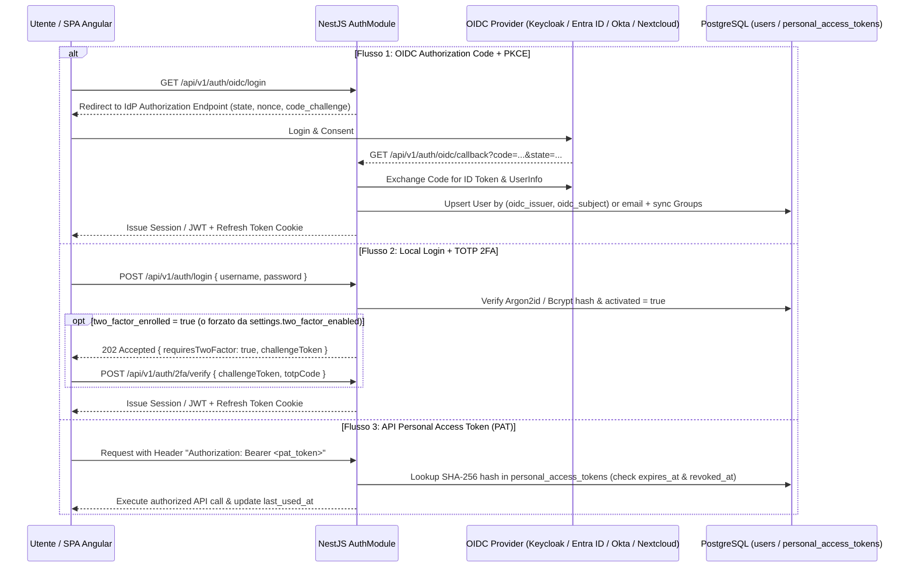

# 06 — Authentication (OIDC + 2FA), Pluggable Storage, CSV Importers & Scheduled Jobs

Questo documento definisce le specifiche per i layer infrastrutturali e operativi di Kestrel-IT: **Autenticazione moderna**, **Storage Pluggable**, il **Motore di Importazione CSV (14 entità)**, il **Generatore di Etichette PDF** e le **26 Notifiche & Cron Jobs**.

---

## 1. Autenticazione: OIDC Nativo + Local Auth + TOTP 2FA + PAT

Kestrel-IT sostituisce le implementazioni legacy SAML/LDAP di Snipe-IT con **OpenID Connect (OIDC)** nativo, affiancato dall'autenticazione locale con **TOTP 2FA** e dai **Personal Access Tokens (PAT)**.



### 1.1 Regole di Sicurezza Auth Estratte da Snipe-IT
- **Compatibilità Hash Password:** Supporto sia per **Argon2id** (nuovi hash) sia per **Bcrypt `$2y$`** (in modo che gli utenti migrati da MySQL Snipe-IT in Fase 4 possano fare login senza dover resettare la password).
- **Gating PAT (`self.api`):** Come fissato in [`routes/web.php`](file:///Users/thor/development/snipe-it/routes/web.php#L51-L74), un utente può generare o revocare i propri Personal Access Token **solo** se possiede il permesso `self.api`.
- **Two-Factor Policy (`settings.two_factor_enabled`):**
  - `0` (Disabled): 2FA disabilitato.
  - `1` (User Opt-in): Gli utenti con permesso `self.two_factor` possono attivarlo volontariamente.
  - `2` (Required for All): Ogni utente è obbligato a completare l'enrollment TOTP al primo login; un admin può resettare il `two_factor_secret` di un utente bloccato.
- **Audit Login Attempts:** Ogni tentativo di login (riuscito o fallito) viene registrato nella tabella `login_attempts` (esposta a `superuser` su `GET /api/v1/settings/login-attempts`).

### 1.2 OIDC Just-In-Time (JIT) Auto-Provisioning & Claim Mapping (Superamento del limite di Snipe-IT)

> [!IMPORTANT]
> **Limite attuale in Snipe-IT (`app/Services/Oidc/OidcUserResolver.php`):**
> In Snipe-IT, `OidcUserResolver` cerca solo un utente già creato manualmente tramite `(oidc_issuer, oidc_subject)` o fallback su `username`, e **rifiuta il login se l'utente non esiste già nel DB** (*"A token that resolves to no existing user is rejected -- there is no just-in-time provisioning"*).
> In **Kestrel-IT**, il layer OIDC implementa il **Just-In-Time (JIT) Auto-Provisioning completo** (configurabile da env/settings con `oidc_auto_provision_users = true`).

#### Algoritmo di Risoluzione & JIT Auto-Provisioning (`OidcUserProvisioningService`):

1. **Step 1 — Match per Identità OIDC Pin (`(oidc_issuer, oidc_subject)`):**
   - Cerca in `users` per `oidc_issuer = claims.iss AND oidc_subject = claims.sub` (includendo controllo `deleted_at IS NULL`).
2. **Step 2 — Fallback Link su Utente Esistente (Primo login OIDC di un utente pre-esistente / migrato):**
   - Se non trovato per `(iss, sub)` e `oidc_link_existing_users = true`, cerca un utente attivo tramite il claim configurato (`OIDC_USERNAME_CLAIM`, default `preferred_username`, oppure `email` se `email_verified === true`), verificando che l'utente non sia già pinnato a un `oidc_issuer` differente.
   - Se trovato, esegue il **pinning automatico** salvando `oidc_issuer = claims.iss` e `oidc_subject = claims.sub`.
3. **Step 3 — Creazione Automatica Just-In-Time (JIT Provisioning se l'utente non esiste):**
   - Se `oidc_auto_provision_users === true`:
     - Crea automaticamente il nuovo record in `users` con `activated = true`, `password = null` (account federato OIDC-only), `oidc_issuer = claims.iss`, `oidc_subject = claims.sub`.
     - **Mappatura Attributi Profilo dai Claims OIDC (`ID Token` + `UserInfo` endpoint):**
       - `username` ← `claims[oidc_username_claim]` (default `preferred_username` o `email`)
       - `email` ← `claims.email`
       - `first_name` ← `claims.given_name` (o split di `claims.name`)
       - `last_name` ← `claims.family_name`
       - `display_name` ← `claims.name`
       - `employee_num` ← `claims[oidc_employee_num_claim]` (opzionale, es. `employee_number`)
       - `jobtitle` ← `claims[oidc_jobtitle_claim]` (opzionale, es. `title`)
       - `phone` ← `claims.phone_number`
       - `locale` ← `claims.locale` (fallback a `settings.locale`)
4. **Step 4 — Sincronizzazione Automatica Gruppi, Ruoli, Company & Location ad ogni Login (`oidc_sync_on_login = true`):**
   - **Default Group & Group Claim Mapping (`claims.groups` / `claims.roles`):**
     - Assegna sempre il gruppo predefinito `settings.oidc_default_group_id` (se configurato) ai nuovi utenti auto-provisionati.
     - Se `oidc_sync_groups = true`, legge l'array `claims[oidc_groups_claim]` (es. `groups` o `realm_access.roles` da Keycloak / Authentik / Entra ID / Nextcloud) e sincronizza la tabella pivot `users_groups` facendo match con i `groups.name` (o tramite una mappa JSON `oidc_group_mapping` che associa i gruppi IdP ai `group_id` di Kestrel-IT).
   - **Company & Location Auto-Assignment (FMCS-aware):**
     - Assegna la company di default (`oidc_default_company_id`) o risolve il claim `claims[oidc_company_claim]` nella tabella pivot `company_user`.
     - Se presente `claims[oidc_department_claim]` o `claims[oidc_location_claim]`, associa (o crea, se `oidc_auto_create_taxonomy = true`) il `Department` e la `Location`.
   - **Auto-Assign Licenses (`autoassign_licenses`):**
     - Alla creazione JIT di un nuovo utente, se nel sistema esistono licenze con auto-assegnazione attiva, esegue il checkout automatico di un `LicenseSeat` libero esattamente come avviene nella creazione manuale di un utente.
   - **Audit Log:** Registra in `action_logs` l'evento `create` con `action_source = 'oidc_jit'`.

---

## 2. Pluggable Storage Layer (`Local`, `Native S3`, `Nextcloud WebDAV`)

In Snipe-IT i file sono sparsi su diverse directory locali/S3 definite nell'enum `App\Enums\FileStorage` (`assets`, `models`, `licenses`, `users`, `locations`, `companies`, `departments`, `suppliers`, `maintenances`, `accessories`, `consumables`, `components`, `audits`, `signatures`, `eulas`, `imports`, `barcodes`, `avatars`, `logos`).

In Kestrel-IT tutti i file passano attraverso un'unica interfaccia `StorageProvider` in `apps/api/src/common/storage/storage.interface.ts`:

```ts
export type StorageBucketCategory =
  | 'assets' | 'models' | 'licenses' | 'users' | 'locations'
  | 'companies' | 'departments' | 'suppliers' | 'maintenances'
  | 'accessories' | 'consumables' | 'components' | 'audits'
  | 'signatures' | 'eulas' | 'imports' | 'barcodes' | 'branding';

export interface StorageProvider {
  putObject(category: StorageBucketCategory, key: string, body: Buffer | Readable, mimeType: string): Promise<void>;
  getObjectStream(category: StorageBucketCategory, key: string): Promise<{ stream: Readable; mimeType: string; size?: number }>;
  deleteObject(category: StorageBucketCategory, key: string): Promise<void>;
  exists(category: StorageBucketCategory, key: string): Promise<boolean>;
  getSignedOrProxyUrl(category: StorageBucketCategory, key: string, expiresInSeconds?: number): Promise<string>;
}
```

### I 3 Adapter Implementati (`STORAGE_DRIVER=local|s3|nextcloud`):
1. **`LocalStorageAdapter`**: Salva su filesystem locale (PVC Kubernetes) sotto `STORAGE_LOCAL_ROOT/<category>/<key>`. Tutti i file privati vengono serviti passando dal controller autenticato e autorizzato (`PermissionsGuard` con `<entity>.files`).
2. **`S3StorageAdapter`**: Usa `@aws-sdk/client-s3` e `@aws-sdk/s3-request-presigner`. Compatibile con AWS S3, MinIO, Cloudflare R2, Ceph, DigitalOcean Spaces (`S3_ENDPOINT`, `S3_REGION`, `S3_BUCKET`, `S3_FORCE_PATH_STYLE`).
3. **`NextcloudWebDavAdapter`**: Usa il protocollo WebDAV di Nextcloud (`NEXTCLOUD_URL`, `NEXTCLOUD_USERNAME`, `NEXTCLOUD_APP_PASSWORD`, `NEXTCLOUD_BASE_PATH`, es. `/remote.php/dav/files/<user>/kestrel-it/<category>/<key>`) con streaming diretto attraverso il proxy NestJS per non esporre mai le credenziali Nextcloud al client browser.

---

## 3. Motore CSV Importer (Le 14 Classi di `app/Importer/*`)

Dall'ispezione di [`../snipe-it/app/Importer/`](file:///Users/thor/development/snipe-it/app/Importer), il sistema di importazione supporta **14 tipi di importazione**:

| Tipo Import (`import_type`) | Classe Originale Snipe-IT | Chiave di Match / Deduplica | Relazioni Auto-Create (Find-or-Create) |
| :--- | :--- | :--- | :--- |
| **`asset`** | `AssetImporter` | `asset_tag` | `AssetModel`, `Category`, `Manufacturer`, `Supplier`, `Location`, `Statuslabel`, `Company`, `User` (checkout automatico se presente nell'import), più tutte le colonne mapped ai **Custom Fields** (`custom_fields JSONB`). |
| **`asset-history`** | `AssetHistoryImporter` | `asset_tag` + storico | Ricostruisce lo storico `action_logs` di checkout/checkin passati per gli asset esistenti. |
| **`assetModel`** | `AssetModelImporter` | `name` + `model_number` | `Category`, `Manufacturer`, `Depreciation`, `CustomFieldset`. |
| **`user`** | `UserImporter` | `username` / `email` | `Company` (popola `company_user`), `Location`, `Department`, `Manager`, `Group`. |
| **`license`** | `LicenseImporter` | `name` + `serial` | `Category`, `Manufacturer`, `Supplier`, `Company`, `Depreciation`, più creazione automatica dei `LicenseSeat` e checkout se presente `assigned_to`. |
| **`accessory`** | `AccessoryImporter` | `name` + `model_number` | `Category`, `Manufacturer`, `Supplier`, `Location`, `Company`. |
| **`consumable`** | `ConsumableImporter` | `name` + `item_no` | `Category`, `Manufacturer`, `Supplier`, `Location`, `Company`. |
| **`component`** | `ComponentImporter` | `name` + `serial` | `Category`, `Manufacturer`, `Supplier`, `Location`, `Company`. |
| **`location`** | `LocationImporter` | `name` | `Parent Location`, `Manager` (`User`), `Company`. |
| **`category`** | `CategoryImporter` | `name` + `category_type` | — |
| **`manufacturer`** | `ManufacturerImporter` | `name` | — |
| **`supplier`** | `SupplierImporter` | `name` | — |

---

## 4. Generatore Etichette PDF, QR Code & Barcode 1D/2D

Mappato da [`LabelsController.php`](file:///Users/thor/development/snipe-it/app/Http/Controllers/LabelsController.php), [`QrCodeController.php`](file:///Users/thor/development/snipe-it/app/Http/Controllers/QrCodeController.php) e [`app/Models/Labels/`](file:///Users/thor/development/snipe-it/app/Models/Labels):
- **Formati Codice a Barre 1D:** `C128` (Code 128), `C39` (Code 39), `EAN13`, `UPCA`, `ITF`.
- **Formati 2D:** `QRCODE` (punta all'URL di dettaglio dell'asset o a `label2_2d_prefix`), `DATAMATRIX`, `PDF417`.
- **Template di Stampa (`label2_template` + `CustomUserLabel`):**
  - Supporto fogli standard Avery (es. `Avery5160`, `Avery5161`, `Avery5162`, `Avery5163`, `Avery5164`), etichette singole Dymo/Zebra (`Dymo30252`, `Dymo30334`, `Zebra`) e dimensioni custom in pollici/mm (`labels_width`, `labels_height`, margini, `labels_per_page`, `label2_empty_row_count` per saltare le etichette già staccate dal foglio).
  - Campi stampabili configurabili (`label2_fields`): `name`, `asset_tag`, `serial`, `model`, `model_number`, `company`, `location`, `purchase_date`, più qualsiasi `CustomField`.

---

## 5. Catalogo delle 26 Notifiche e Job Schedulati (`app/Notifications/*` & `app/Console/Kernel.php`)

### 5.1 Canali di Notifica
1. **Email (SMTP / Nodemailer)** con template HTML responsive e logo aziendale (`settings.email_logo`), più CC automatico a `settings.admin_cc_email` (se `admin_cc_always = true` o per alert).
2. **Webhook Multi-Provider** (configurabile a livello globale in `settings` **e** con override per singola `Company` in `companies.webhook_*`):
   - **Slack**
   - **Microsoft Teams**
   - **Google Chat**
   - **Generic JSON Webhook**
   - *(Con validazione anti-SSRF [`ExternalUrl`](file:///Users/thor/development/snipe-it/app/Models/Company.php#L82) sugli endpoint webhook)*.

### 5.2 Tabella delle 26 Notifiche di Snipe-IT
- **Checkout (`5`):** `CheckoutAssetNotification`, `CheckoutAccessoryNotification`, `CheckoutConsumableNotification`, `CheckoutComponentNotification`, `CheckoutLicenseSeatNotification`.
- **Checkin (`4`):** `CheckinAssetNotification`, `CheckinAccessoryNotification`, `CheckinComponentNotification`, `CheckinLicenseSeatNotification`.
- **EULA & Acceptance (`4`):** `AcceptanceItemAcceptedNotification`, `AcceptanceItemAcceptedToUserNotification`, `AcceptanceItemDeclinedNotification`, `UnacceptedAssetReminderNotification`.
- **Self-Service Requests (`2`):** `RequestAssetNotification`, `RequestAssetCancelation`.
- **Audits (`2`):** `AuditNotification`, `SendUpcomingAuditNotification`.
- **Alerts Schedulati (`5`):** `ExpectedCheckinNotification` (all'utente), `ExpectedCheckinAdminNotification` (agli admin), `ExpiringAssetsNotification` (garanzie/EOL in scadenza), `ExpiringLicenseNotification` (licenze in scadenza), `InventoryAlert` (scorte sotto `min_amt`).
- **Account & Utility (`4`):** `WelcomeNotification`, `FirstAdminNotification`, `CurrentInventory` (invio lista asset a un utente), `MailTest`.

### 5.3 Cron Schedule (`apps/api/src/jobs/scheduler.service.ts`)
Mappato da [`app/Console/Kernel.php`](file:///Users/thor/development/snipe-it/app/Console/Kernel.php):
- **Ogni 15 minuti:** Pulizia token di reset password e challenge 2FA scaduti (`auth:clear-resets`).
- **Ogni giorno (se `settings.alerts_enabled === true`):**
  1. `inventory-alerts`: Controlla tutti gli `AssetModel`, `Accessory`, `Consumable`, `Component`, `License` la cui disponibilità residua è $\le \text{min\_amt}$ (o `settings.alert_threshold`) e invia `InventoryAlert`.
  2. `expiring-alerts`: Controlla Asset con garanzia/EOL e Licenze con `expiration_date` entro `settings.alert_interval` giorni e invia `ExpiringAssetsNotification` / `ExpiringLicenseNotification`.
  3. `expected-checkin`: Controlla Asset con `expected_checkin` scaduta o entro `settings.due_checkin_days` e invia `ExpectedCheckinNotification` + `ExpectedCheckinAdminNotification`.
  4. `upcoming-audits`: Controlla Asset con `next_audit_date` scaduta o entro `settings.audit_warning_days` e invia `SendUpcomingAuditNotification`.
- **Ogni giorno:** Pulizia export/backup temporanei scaduti.
