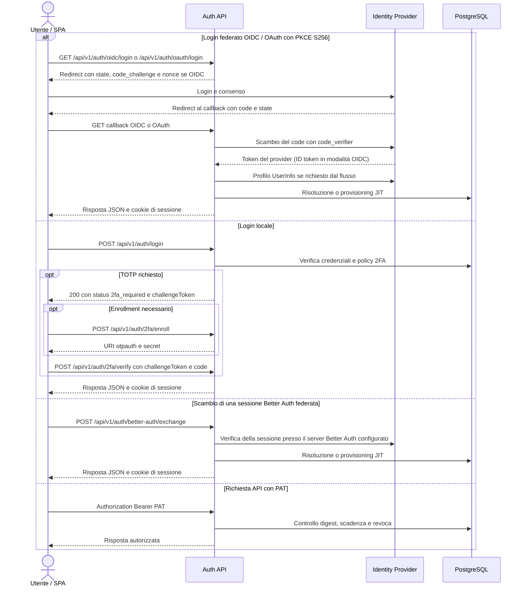

# 06 — Authentication (OIDC, OAuth 2.0/2.1, Better Auth, 2FA & PAT), Pluggable Storage, CSV Importers & Scheduled Jobs

Questo documento definisce le specifiche per i layer infrastrutturali e operativi di Kestrel-IT: **Autenticazione moderna**, **Storage Pluggable**, il **Motore di Importazione CSV (12 tipi)**, il **Generatore di Etichette PDF** e le **26 Notifiche & Cron Jobs**.

---

## 1. Autenticazione

Snipe-IT supporta autenticazione API con bearer token OIDC, Passport OAuth, PAT, SAML, LDAP e autenticazione locale con TOTP. La sincronizzazione utenti LDAP è un flusso di provisioning dedicato. [Test OIDC API](https://github.com/grokability/snipe-it/blob/576e1c3c9e1ad67b7c7d53dcde49b9b7b5d253f8/tests/Feature/Authentication/OidcApiAuthTest.php#L113-L140), [sincronizzazione LDAP](https://github.com/grokability/snipe-it/blob/576e1c3c9e1ad67b7c7d53dcde49b9b7b5d253f8/routes/web/users.php#L9-L27)

Nei passi 1.4 e 1.4b sono presenti moduli API per login locale con TOTP, OIDC e OAuth con PKCE, PAT, configurazione iniziale e scambio di sessione Better Auth. L'avvio dell'API compilata e la verifica dei flussi HTTP restano aperti nel [piano di lavoro](../PLAN.md). Per le installazioni SAML o LDAP, Kestrel-IT adotta OIDC/OAuth con PKCE e JIT tramite un broker esterno come Keycloak, Authentik o Entra ID. Il provisioning push di utenti e gruppi è previsto con SCIM 2.0 nel Piano 4.2. La compatibilità con Passport e bearer OIDC per l'API resta da definire. [Mappa funzionale](08-upstream-feature-map.md), [Piano 4.2](../PLAN.md)

Il diagramma descrive i flussi esposti dai controller. La verifica HTTP dei flussi è ancora aperta.



### 1.1 Login locale, 2FA e PAT

- Il login locale verifica le password `scrypt` e gli hash bcrypt `$2y$` migrati da Snipe-IT. `POST /api/v1/auth/login` restituisce HTTP 200 con `status: '2fa_required'` e un `challengeToken` quando serve completare TOTP. L'enrollment restituisce un URI `otpauth` e la verifica riceve `challengeToken` e `code`. I nuovi segreti TOTP sono cifrati con AES-256-GCM. [Controller Auth](../apps/api/src/modules/auth/auth.controller.ts), [servizio Auth](../apps/api/src/modules/auth/auth.service.ts)
- Gli endpoint `/api/v1/account/personal-access-tokens` verificano `self.api` e lo stato `twoFactorVerified` del contesto. I token Kestrel-IT hanno prefisso `kst_` e il database conserva il digest SHA-256. Snipe-IT lega la gestione dei PAT allo stesso permesso. [Servizio PAT](../apps/api/src/modules/auth/pat.service.ts), [rotte Snipe-IT](https://github.com/grokability/snipe-it/blob/576e1c3c9e1ad67b7c7d53dcde49b9b7b5d253f8/routes/web.php#L51-L74)
- La rotazione del refresh token di Kestrel-IT registra gli identificativi consumati nella memoria del singolo processo. Il logout cancella i cookie. Persistenza, revoca server-side e verifica della policy MFA restano da completare. [Servizio Auth](../apps/api/src/modules/auth/auth.service.ts), [controller Auth](../apps/api/src/modules/auth/auth.controller.ts)

### 1.2 OIDC, OAuth con PKCE e provisioning JIT

Il resolver OIDC di Snipe-IT richiede un utente esistente e cerca la coppia issuer/subject o uno username. Kestrel-IT aggiunge il provisioning JIT configurabile e usa la coppia `(oidc_issuer, oidc_subject)` per la risoluzione iniziale. [Resolver Snipe-IT](https://github.com/grokability/snipe-it/blob/576e1c3c9e1ad67b7c7d53dcde49b9b7b5d253f8/app/Services/Oidc/OidcUserResolver.php), [provisioning Kestrel-IT](../apps/api/src/modules/auth/oidc-provisioning.service.ts)

- Le rotte `/api/v1/auth/oidc/{login,callback}` e `/api/v1/auth/oauth/{login,callback}` espongono il flusso Authorization Code con `state` e PKCE S256. In modalità OIDC il servizio verifica l'ID token e il nonce. In modalità OAuth senza ID token recupera il profilo dall'endpoint UserInfo e lo normalizza per il provisioning. [Servizio Auth](../apps/api/src/modules/auth/auth.service.ts)
- Il linking degli account esistenti usa il claim username configurato e, come fallback, l'email verificata. La verifica del pinning e del collegamento degli account resta da completare. La creazione JIT registra un evento `oidc_jit` in `action_logs`. [Servizio provisioning](../apps/api/src/modules/auth/oidc-provisioning.service.ts)
- Il servizio può sincronizzare il profilo, aggiornare `users_groups` dai claim e assegnare la company di default in `company_user`. L'assegnazione da claim delle company e il checkout automatico delle postazioni licenza sono estensioni da implementare. [Servizio provisioning](../apps/api/src/modules/auth/oidc-provisioning.service.ts)

#### Mappatura dei claim nel provisioning JIT

| Destinazione | Claim o regola applicata |
| :--- | :--- |
| `users.oidc_issuer`, `users.oidc_subject` | `iss`, `sub`. La coppia identifica l'account federato. |
| `users.username` | Claim configurato con `OIDC_USERNAME_CLAIM` (default `preferred_username`). Alla creazione ricade su `email` o `sub`. |
| `users.email` | `email`. Il fallback di linking per email richiede `email_verified === true`. |
| `users.first_name`, `users.last_name` | `given_name`, `family_name`. Alla creazione può usare `name` per ricavare i nomi e lo username come ultimo fallback per il nome. |
| `users.display_name` | `name` o, alla creazione, nome e cognome concatenati. |
| `users.employee_num`, `users.jobtitle`, `users.phone` | `employee_number`, `title` o `job_title`, `phone_number`. |
| `users.locale` | `locale`, con fallback al locale dell'istanza alla creazione. |
| `users_groups` | Claim gruppi configurabile (default `groups`), mappa `oidc_group_mapping` o corrispondenza per nome e gruppo di default, secondo le impostazioni di sync. |
| `company_user` | Company predefinita `oidc_default_company_id`, se configurata. |

Il sync del profilo aggiorna i claim presenti e mantiene lo username locale. [Servizio provisioning](../apps/api/src/modules/auth/oidc-provisioning.service.ts), [normalizzazione OAuth](../apps/api/src/modules/auth/oauth21.util.ts)

### 1.3 Prima configurazione e bootstrap headless

Snipe-IT verifica la presenza di utenti e impostazioni, guida l'operatore nella creazione del primo amministratore e gestisce i redirect del setup via middleware. [Controller upstream](https://github.com/grokability/snipe-it/blob/576e1c3c9e1ad67b7c7d53dcde49b9b7b5d253f8/app/Http/Controllers/SetupController.php), [middleware upstream](https://github.com/grokability/snipe-it/blob/576e1c3c9e1ad67b7c7d53dcde49b9b7b5d253f8/app/Http/Middleware/CheckForSetup.php), [condizione di completamento](https://github.com/grokability/snipe-it/blob/576e1c3c9e1ad67b7c7d53dcde49b9b7b5d253f8/app/Models/Setting.php#L147-L160)

#### Wizard Angular previsto nel Piano 1.6

1. **Pre-flight.** `SetupWizardComponent` chiama `GET /api/v1/setup/status`. Se `setupCompleted` è vero, il guard lo reindirizza fuori da `/setup`. Altrimenti il wizard mostra `checks.database`, `checks.storageWritable`, `checks.oidcConfigured` e `checks.smtpConfigured`. Il controllo DB usa `SELECT 1`. Per S3, Nextcloud, OIDC e SMTP i controlli attuali rilevano la presenza della configurazione. Per lo storage locale verificano la scrivibilità. [Servizio setup](../apps/api/src/modules/setup/setup.service.ts)
2. **Istanza e asset tag.** Il wizard raccoglie `siteName`, `locale`, `defaultCurrency` e `fullMultipleCompaniesSupport`. Raccoglie anche le impostazioni per i tag `autoIncrementAssets`, `autoIncrementPrefix` e `zerofillCount` e, facoltativamente, `emailDomain` ed `emailFormat`. I valori di questo step restano nel form fino all'invio finale. [Schema richiesta](../packages/shared/src/schemas/auth-and-setup.ts)
3. **Primo superuser.** Il wizard raccoglie `firstName`, `lastName`, `username`, `email` e `password` e invia tutti i dati con `POST /api/v1/setup/complete`. L'API crea il superuser, la riga `settings` e le etichette di stato in una transazione, poi restituisce il payload di sessione e imposta i cookie. Il wizard usa quella sessione per accedere a `/dashboard`. Dopo il completamento, l'API rifiuta nuove scritture di setup con HTTP 403. [Controller setup](../apps/api/src/modules/setup/setup.controller.ts), [mappa Angular](07-frontend-angular-map.md)

#### Bootstrap headless

Il bootstrap headless usa `BOOTSTRAP_ADMIN_USERNAME`, `BOOTSTRAP_ADMIN_EMAIL`, `BOOTSTRAP_ADMIN_PASSWORD` e facoltativamente `BOOTSTRAP_SITE_NAME`. [Servizio bootstrap](../apps/api/src/db/bootstrap.service.ts)

### 1.4 Bridge Better Auth

`POST /api/v1/auth/better-auth/exchange` accetta un profilo firmato o verifica una sessione presso il server Better Auth configurato tramite `/api/auth/get-session`. Il bridge passa il profilo al servizio JIT di Kestrel-IT. La configurazione e gli hook Drizzle preparano l'integrazione embedded. Il motore embedded, i plugin social e le passkey sono ancora nel piano. [Servizio Better Auth](../apps/api/src/modules/auth/better-auth.service.ts), [piano](../PLAN.md)

---

## 2. Pluggable Storage Layer (`Local`, `Native S3`, `Nextcloud WebDAV`)

In Snipe-IT i file sono sparsi su diverse directory locali/S3 definite nell'enum `App\Enums\FileStorage` (`assets`, `models`, `licenses`, `users`, `locations`, `companies`, `departments`, `suppliers`, `maintenances`, `accessories`, `consumables`, `components`, `audits`, `signatures`, `eulas`, `imports`, `barcodes`, `avatars`, `logos`).

In Kestrel-IT tutti i file passano attraverso un'unica interfaccia `StorageProvider` in `apps/api/src/common/storage/storage.interface.ts`:

```ts
export type StorageBucketCategory =
  | 'assets' | 'models' | 'licenses' | 'users' | 'locations'
  | 'companies' | 'departments' | 'suppliers' | 'maintenances'
  | 'accessories' | 'consumables' | 'components' | 'audits'
  | 'signatures' | 'eulas' | 'imports' | 'barcodes' | 'branding';

export interface StorageProvider {
  putObject(category: StorageBucketCategory, key: string, body: Buffer | Readable, mimeType: string): Promise<void>;
  getObjectStream(category: StorageBucketCategory, key: string): Promise<{ stream: Readable; mimeType: string; size?: number }>;
  deleteObject(category: StorageBucketCategory, key: string): Promise<void>;
  exists(category: StorageBucketCategory, key: string): Promise<boolean>;
  getSignedOrProxyUrl(category: StorageBucketCategory, key: string, expiresInSeconds?: number): Promise<string>;
}
```

### I 3 Adapter Implementati (`STORAGE_DRIVER=local|s3|nextcloud`):
1. **`LocalStorageAdapter`**: Salva su filesystem locale (PVC Kubernetes) sotto `STORAGE_LOCAL_ROOT/<category>/<key>`. Tutti i file privati vengono serviti passando dal controller autenticato e autorizzato (`PermissionsGuard` con `<entity>.files`).
2. **`S3StorageAdapter`**: Usa `@aws-sdk/client-s3` e `@aws-sdk/s3-request-presigner`. Compatibile con AWS S3, MinIO, Cloudflare R2, Ceph, DigitalOcean Spaces (`S3_ENDPOINT`, `S3_REGION`, `S3_BUCKET`, `S3_FORCE_PATH_STYLE`).
3. **`NextcloudWebDavAdapter`**: Usa il protocollo WebDAV di Nextcloud (`NEXTCLOUD_URL`, `NEXTCLOUD_USERNAME`, `NEXTCLOUD_APP_PASSWORD`, `NEXTCLOUD_BASE_PATH`, es. `/remote.php/dav/files/<user>/kestrel-it/<category>/<key>`) con streaming diretto attraverso il proxy NestJS per non esporre mai le credenziali Nextcloud al client browser.

---

## 3. Importazione CSV

Il [controller di importazione](https://github.com/grokability/snipe-it/blob/576e1c3c9e1ad67b7c7d53dcde49b9b7b5d253f8/app/Http/Controllers/Api/ImportController.php#L365-L414) gestisce **12 tipi selezionabili**. La [directory degli importer](https://github.com/grokability/snipe-it/tree/576e1c3c9e1ad67b7c7d53dcde49b9b7b5d253f8/app/Importer) contiene anche le classi di base `Importer` e `ItemImporter`.

| Tipo Import (parametro HTTP `import-type`) | Classe Originale Snipe-IT | Chiave di Match / Deduplica | Relazioni Auto-Create (Find-or-Create) |
| :--- | :--- | :--- | :--- |
| **`asset`** | `AssetImporter` | `asset_tag` | `AssetModel`, `Category`, `Manufacturer`, `Supplier`, `Location`, `Statuslabel`, `Company`, `User` (checkout automatico se presente nell'import), più tutte le colonne mapped ai **Custom Fields** (`custom_fields JSONB`). |
| **`assetHistory`** | `AssetHistoryImporter` | `asset_tag` + storico | Ricostruisce lo storico `action_logs` di checkout/checkin passati per gli asset esistenti. |
| **`assetModel`** | `AssetModelImporter` | `name` + `model_number` | `Category`, `Manufacturer`, `Depreciation`, `CustomFieldset`. |
| **`user`** | `UserImporter` | `username` / `email` | `Company` (popola `company_user`), `Location`, `Department`, `Manager`, `Group`. |
| **`license`** | `LicenseImporter` | `name` + `serial` | `Category`, `Manufacturer`, `Supplier`, `Company`, `Depreciation`, più creazione automatica dei `LicenseSeat` e checkout se presente `assigned_to`. |
| **`accessory`** | `AccessoryImporter` | `name` + `model_number` | `Category`, `Manufacturer`, `Supplier`, `Location`, `Company`. |
| **`consumable`** | `ConsumableImporter` | `name` + `item_no` | `Category`, `Manufacturer`, `Supplier`, `Location`, `Company`. |
| **`component`** | `ComponentImporter` | `name` + `serial` | `Category`, `Manufacturer`, `Supplier`, `Location`, `Company`. |
| **`location`** | `LocationImporter` | `name` | `Parent Location`, `Manager` (`User`), `Company`. |
| **`category`** | `CategoryImporter` | `name` + `category_type` | — |
| **`manufacturer`** | `ManufacturerImporter` | `name` | — |
| **`supplier`** | `SupplierImporter` | `name` | — |

---

## 4. Generatore Etichette PDF, QR Code & Barcode 1D/2D

Mappato da [`LabelsController.php`](https://github.com/grokability/snipe-it/blob/576e1c3c9e1ad67b7c7d53dcde49b9b7b5d253f8/app/Http/Controllers/LabelsController.php), [`QrCodeController.php`](https://github.com/grokability/snipe-it/blob/576e1c3c9e1ad67b7c7d53dcde49b9b7b5d253f8/app/Http/Controllers/QrCodeController.php) e [`app/Models/Labels/`](https://github.com/grokability/snipe-it/tree/576e1c3c9e1ad67b7c7d53dcde49b9b7b5d253f8/app/Models/Labels):
- **Formati Codice a Barre 1D:** `C128` (Code 128), `C39` (Code 39), `EAN13`, `UPCA`, `ITF`.
- **Formati 2D:** `QRCODE` (punta all'URL di dettaglio dell'asset o a `label2_2d_prefix`), `DATAMATRIX`, `PDF417`.
- **Template di Stampa (`label2_template` + `CustomUserLabel`):**
  - Supporto fogli standard Avery (es. `Avery5160`, `Avery5161`, `Avery5162`, `Avery5163`, `Avery5164`), etichette singole Dymo/Zebra (`Dymo30252`, `Dymo30334`, `Zebra`) e dimensioni custom in pollici/mm (`labels_width`, `labels_height`, margini, `labels_per_page`, `label2_empty_row_count` per saltare le etichette già staccate dal foglio).
  - Campi stampabili configurabili (`label2_fields`): `name`, `asset_tag`, `serial`, `model`, `model_number`, `company`, `location`, `purchase_date`, più qualsiasi `CustomField`.

---

## 5. Catalogo delle 26 Notifiche e Job Schedulati (`app/Notifications/*` & `app/Console/Kernel.php`)

### 5.1 Canali di Notifica
1. **Email (SMTP / Nodemailer)** con template HTML responsive e logo aziendale (`settings.email_logo`), più CC automatico a `settings.admin_cc_email` (se `admin_cc_always = true` o per alert).
2. **Webhook Multi-Provider** (configurabile a livello globale in `settings` **e** con override per singola `Company` in `companies.webhook_*`):
   - **Slack**
   - **Microsoft Teams**
   - **Google Chat**
   - **Generic JSON Webhook**
   - *(Con validazione anti-SSRF [`ExternalUrl`](https://github.com/grokability/snipe-it/blob/576e1c3c9e1ad67b7c7d53dcde49b9b7b5d253f8/app/Models/Company.php#L82) sugli endpoint webhook)*.

### 5.2 Tabella delle 26 Notifiche di Snipe-IT
- **Checkout (`5`):** `CheckoutAssetNotification`, `CheckoutAccessoryNotification`, `CheckoutConsumableNotification`, `CheckoutComponentNotification`, `CheckoutLicenseSeatNotification`.
- **Checkin (`4`):** `CheckinAssetNotification`, `CheckinAccessoryNotification`, `CheckinComponentNotification`, `CheckinLicenseSeatNotification`.
- **EULA & Acceptance (`4`):** `AcceptanceItemAcceptedNotification`, `AcceptanceItemAcceptedToUserNotification`, `AcceptanceItemDeclinedNotification`, `UnacceptedAssetReminderNotification`.
- **Self-Service Requests (`2`):** `RequestAssetNotification`, `RequestAssetCancelation`.
- **Audits (`2`):** `AuditNotification`, `SendUpcomingAuditNotification`.
- **Alerts Schedulati (`5`):** `ExpectedCheckinNotification` (all'utente), `ExpectedCheckinAdminNotification` (agli admin), `ExpiringAssetsNotification` (garanzie/EOL in scadenza), `ExpiringLicenseNotification` (licenze in scadenza), `InventoryAlert` (scorte sotto `min_amt`).
- **Account & Utility (`4`):** `WelcomeNotification`, `FirstAdminNotification`, `CurrentInventory` (invio lista asset a un utente), `MailTest`.

### 5.3 Cron Schedule & Cache In-Memory (`apps/api/src/jobs/scheduler.service.ts`)
Mappato da [`app/Console/Kernel.php`](https://github.com/grokability/snipe-it/blob/576e1c3c9e1ad67b7c7d53dcde49b9b7b5d253f8/app/Console/Kernel.php):

> [!NOTE]
> **Architettura senza Redis:** La cache (`settings`, chiavi JWKS OIDC) è gestita **In-Memory** (con invalidazione multi-pod opzionale tramite PostgreSQL `LISTEN/NOTIFY`) e i cron job utilizzano `@nestjs/schedule` coordinato tramite **PostgreSQL Advisory Locks** (`pg_try_advisory_lock`), senza alcuna dipendenza da Redis.

- **Ogni 15 minuti:** Pulizia token di reset password e challenge 2FA scaduti (`auth:clear-resets`).
- **Ogni giorno (se `settings.alerts_enabled === true`):**
  1. `inventory-alerts`: Controlla tutti gli `AssetModel`, `Accessory`, `Consumable`, `Component`, `License` la cui disponibilità residua è $\le \text{min\_amt}$ (o `settings.alert_threshold`) e invia `InventoryAlert`.
  2. `expiring-alerts`: Controlla Asset con garanzia/EOL e Licenze con `expiration_date` entro `settings.alert_interval` giorni e invia `ExpiringAssetsNotification` / `ExpiringLicenseNotification`.
  3. `expected-checkin`: Controlla Asset con `expected_checkin` scaduta o entro `settings.due_checkin_days` e invia `ExpectedCheckinNotification` + `ExpectedCheckinAdminNotification`.
  4. `upcoming-audits`: Controlla Asset con `next_audit_date` scaduta o entro `settings.audit_warning_days` e invia `SendUpcomingAuditNotification`.
- **Ogni giorno:** Pulizia export/backup temporanei scaduti.
